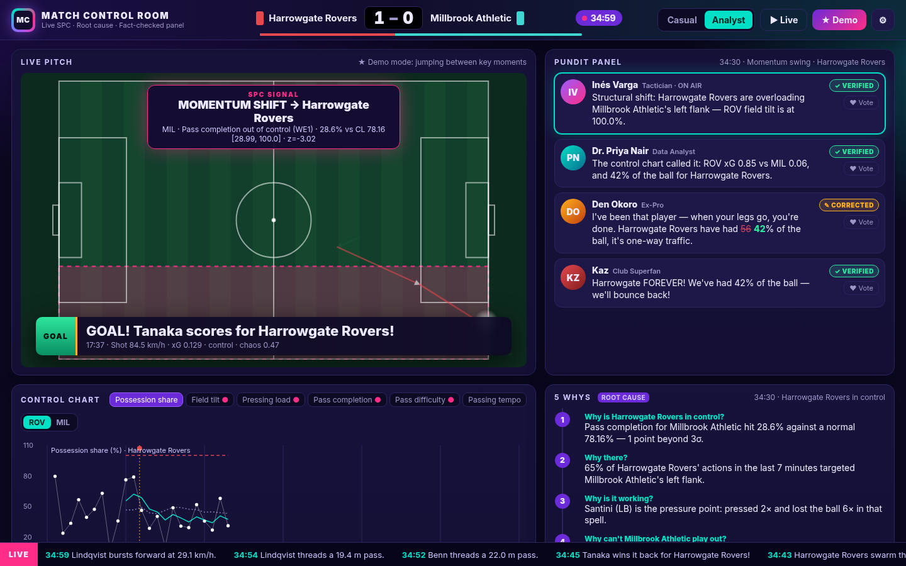
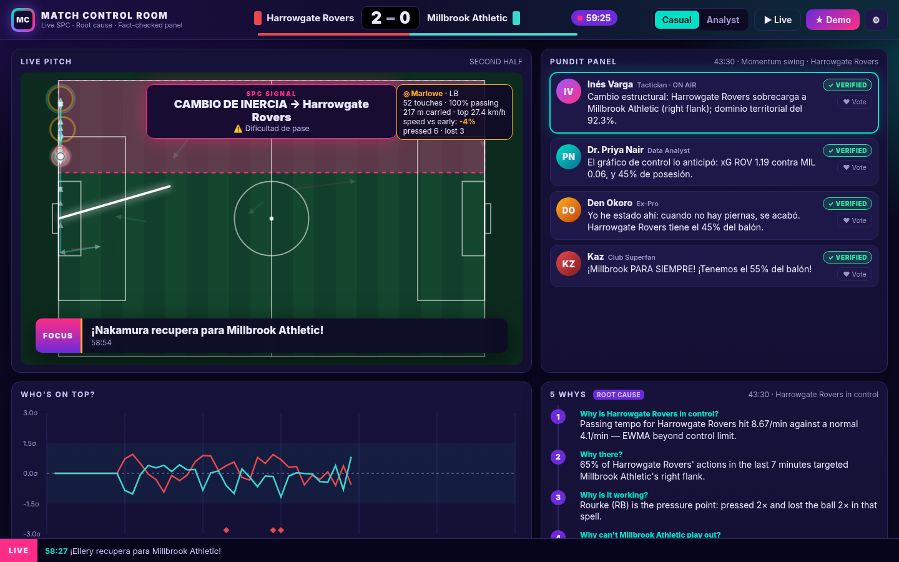
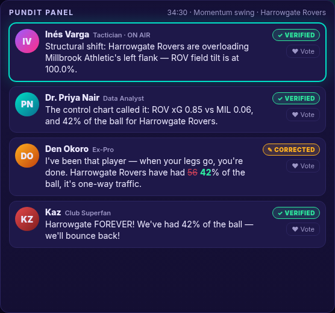
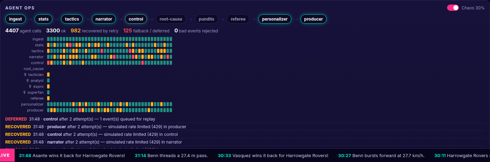
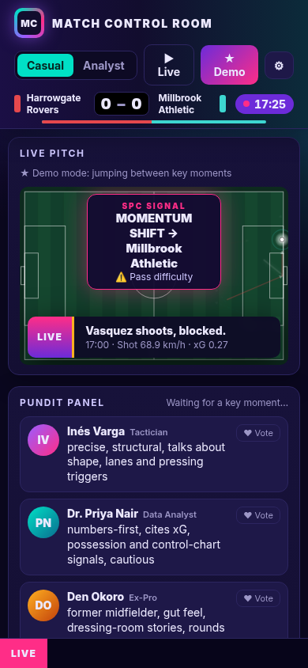
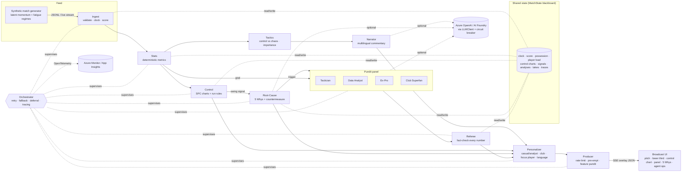

# ⚽ Match Control Room

**Statistical Process Control meets the TV gallery.** Match Control Room is a multi-agent system that watches a live stream of match events. It flags momentum swings with the same SPC control charts used on automotive production lines. It explains each swing with a live Lean **5 Whys**, then puts a **fact-checked pundit panel** on air, personalised for each viewer.

> Built for the *Inside the Game: Developer Hackathon* (Microsoft × Premier League). **All data is synthetic.** Harrowgate Rovers, Millbrook Athletic and all players are fictional, and no league data, names or marks are used.



| | |
|---|---|
|  |  |
|  |  |

## Why it's different
1. **SPC for football.** The Control agent keeps live EWMA and X-bar control charts (centre line, UCL and LCL) per team for six process metrics: possession share, field tilt, pressing load, pass completion, pass difficulty and passing tempo. It applies the **Western Electric / Nelson run rules**. When two or more charts agree, it raises a *momentum swing*, the football equivalent of a production line drifting out of control.
2. **Live root cause.** The Root-Cause agent runs a **5 Whys** on each swing using only event evidence: what changed, where on the pitch, which player is the pressure point, whether that player is physically declining (sprint-speed drop), the systemic cause, and a **countermeasure**.
3. **A pundit panel that can't lie on air.** Four specialist pundits with different voices and biases give their takes: Tactician, Data Analyst, Ex-Pro, and a Club Superfan biased toward *your* club. A **Referee agent fact-checks every number** against the shared state and corrects, rejects or flags hallucinations. A **Producer agent** decides what goes on screen.
4. **Proven on data, not vibes.** The generator injects hidden momentum and fatigue regimes, and `validate.py` scores the agents against that hidden ground truth across 60 matches (see [Validation](#validation-data-innovation)).

## Architecture


### The agents
| Agent | Role | LLM? | Owns on the blackboard | Failure policy |
|---|---|---|---|---|
| **Ingest** | Validate the schema, ordering and coordinates; keep clock, possession and score | no | clock, score, possession, recent events | bad events are rejected and logged, never crash the pipeline |
| **Stats** | Exact metrics: pass distance, speed, difficulty, progression; shot speed and xG; player sprint speed and distance; tags at thresholds (sprint ≥25 km/h, long pass ≥30 m, rocket ≥100 km/h, high press ≥0.8) | **never** | pass, shot and player tallies | retry → minimal stats |
| **Tactics** | Phase (control vs chaos), pressing team, tempo, *why this moment matters*, importance score | no | – | retry → neutral frame |
| **Narrator** | One-line commentary. 5 offline languages; any language via Azure OpenAI | optional | – | retry → template |
| **Control** | Rolling SPC charts, run rules, momentum index, swing detection | no | charts, signals, momentum | retry → **deferral**: missed events are replayed on the next successful run, so charts stay exact |
| **Root-Cause** | Evidence-backed 5 Whys and a countermeasure | optional (translation) | analyses | retry → one-line degraded explanation |
| **Pundits ×4** | Distinct voices and biases; every take carries structured `claims` | optional (JSON mode) | takes | per-pundit fallback; the panel degrades to n−1 |
| **Referee** | Checks every claim against `state.facts()`: verified, corrected, rejected or flagged | no | verdicts | if it fails, takes are marked *unchecked* and **the Producer refuses to air them** |
| **Personalizer** | Casual vs analyst depth, club and focus-player boosts, language, focus-player card | no | – | retry → unpersonalised |
| **Producer** | Broadcast director: lower-third slot, pre-emption, queue, ticker; picks the featured pundit (viewer choice > votes > best verified) | no | on-air log | retry → degraded "air the top item" |
| **Debugger** | Watchdog over all the others. It reads traces, shared state and LLM health, then detects retries, fallbacks, deferrals and retry storms; slow calls; rejected events; out-of-range stats; possession that doesn't add to 100; stalled feeds; and LLM failures, 429s and an open circuit. Each finding is de-duplicated and gets a severity, a likely cause and a fix. Shown via `GET /api/debug`, SSE `debug` events and the 🐞 panel | no | its own findings (read-only on the blackboard) | isolated checks inside a guard: a Debugger bug can never stop the pipeline |

**Something no single agent could do:** a momentum swing is detected statistically (Control), explained causally (Root-Cause), debated from four angles (Pundits), made trustworthy (Referee) and shaped for each viewer (Personalizer + Producer). Each step needs another agent's output on the shared blackboard.

**Handoffs and recovery.** `Orchestrator.call()` wraps every agent step with fault injection, retry with exponential backoff, a fallback, and a trace span. The LLM gateway adds a timeout and a **circuit breaker**. Chaos mode (UI toggle, `fault_rate`) injects timeouts, 429s, exceptions and malformed output. Under 35% injected failures the test suite checks that score, possession and every SPC signal are **identical** to a clean run (`tests/test_orchestrator.py`).

### Overlay contract (`mcr.overlay/v2`)
Server-Sent Events from `GET /api/stream`. The event types are `tick`, `chart`, `signal`, `alert`, `lower_third`, `ticker`, `whys`, `panel`, `focus`, `trace`, `phase`, `meta` and `end`. Every broadcast item has this shape:
```json
{"schema":"mcr.overlay/v2","channel":"lower_third","kind":"narration","match_time_s":1647.2,"clock":"27:27",
 "display":{"start_s":1647.2,"duration_s":6,"anchor":{"x":71.2,"y":18.4}},"priority":0.62,"highlight":"club",
 "lang":"es","persona":"analyst","text":"…","text_source":"template|llm","tags":["big_chance"],"metrics":{…}}
```
Pitch coordinates are metres on a 105 × 68 pitch. The home side attacks +x, and the home side's left flank is low y.

## Validation (data innovation)
`python -m match_insights.validate --seeds 60` replays 60 synthetic matches and scores the agents against the **hidden** regimes that the pipeline never sees:

| Metric (60 seeds) | Value |
|---|---|
| Momentum regimes detected (swing signal, correct team) | 66% |
| Fatigue-collapse regimes detected | 77% |
| Median detection delay | 5.4 min |
| Swing signals / match | 10.9 |
| Signal precision (inside a true regime) | 63% |
| P(goal by momentum team ≤10 min after signal) | 26% |
| …same at a random moment | 17% |
| **Lift** | 1.5 × |
| Fatigue spell analysed by Root-Cause | 77% |
| Root-Cause named the true fatigued player | 53% |
| …and diagnosed fatigue as the cause | 38% |
| Goals with a signal in the prior 10 min (vs random timing) | 42% (random: 45%) |

What this shows, stated honestly:
- **Regimes are detected.** Swing signals catch most injected momentum regimes, about 5 minutes after onset. About 63% of swing signals fall inside a true regime for the correct team, with roughly 4 false alarms per match.
- **Signals carry predictive information.** After a swing signal, the team with momentum scores in the next 10 minutes about **1.5×** as often as at a random moment.
- **But we don't claim to predict goals.** The share of goals with *any* signal in the previous 10 minutes is no better than random timing, because signals are frequent. "Predicts goals" would be over-claiming.
- **Root cause works on real cause-and-effect.** For the injected fatigue collapse, the Root-Cause agent names the exact tired full-back in about half of all matches (about 7 in 10 of the spells it analyses) from sprint-speed decline and turnover evidence alone. Picking at random from the players on that flank would succeed about 1 time in 4.

## Run it (offline, no keys)
```bash
python -m venv .venv && . .venv/bin/activate
pip install -r requirements-dev.txt
uvicorn match_insights.server:app --port 8000        # open http://localhost:8000 → ★ Demo
pytest -q                                            # 48 tests: SPC rules, referee, recovery, API, LLM providers (mocked HTTP)
python -m match_insights.generator --seed 11 --out data/match.jsonl   # writes the .truth.json sidecar too
python -m match_insights.replay data/match.jsonl --persona analyst --club HAR --lang de --fault-rate 0.3
python -m match_insights.validate --seeds 60
python scripts/screenshots.py http://localhost:8000  # needs: playwright install chromium
```
- **★ Demo** jumps between the key moments: an offline pre-pass finds goals and swings, and the stream slows to 8× around them. A full demo plays in about 90 seconds.
- **▶ Live** replays the whole match at the chosen speed.
- **URL parameters** set up a demo directly: `?autoplay=demo&persona=analyst&club=HAR&player=HAR-3&lang=es&chaos=0.3&start=55`.

### AI providers (optional)
There is one gateway, `match_insights/llm.py`. It picks a provider in this order: **Azure OpenAI > GitHub Models > offline templates**.

| Provider | Enable with | Notes |
|---|---|---|
| Azure OpenAI / AI Foundry | `AZURE_OPENAI_ENDPOINT`, `AZURE_OPENAI_DEPLOYMENT`, and a key or managed identity | Production path |
| GitHub Models (Azure-hosted OpenAI models) | `GITHUB_MODELS_TOKEN` or `GITHUB_TOKEN` (PAT with `models:read`); optional `GITHUB_MODELS_MODEL` (default `openai/gpt-4o-mini`) and `GITHUB_MODELS_ENDPOINT` (default `https://models.github.ai/inference`) | See the warning below |
| Offline | nothing | Deterministic templates in 5 languages |

> ⚠️ **GitHub Models retirement.** GitHub's documentation says GitHub Models was fully retired on 30 July 2026, and its inference endpoint now answers with a plain-text stub. The provider is implemented and tested against mocked HTTP. Because the endpoint is configurable, any OpenAI-compatible endpoint (for example Azure AI Foundry) can be plugged in with `GITHUB_MODELS_ENDPOINT` and `GITHUB_MODELS_MODEL`. When the endpoint doesn't return a real completion, the app falls back to templates automatically.

**Free-tier protection:**
- The LLM is only called for important moments: pundit takes on goals and swings, narration with importance ≥ 0.5, and languages that have no offline templates.
- Prompt and response pairs are cached in an LRU cache.
- Calls are spaced on the client side (`GITHUB_MODELS_RPM`, default 10 per minute).
- On a 429, the gateway waits once if `Retry-After` is 2 s or less. Otherwise it pauses LLM calls for the whole rate-limit window, and agents use templates until then.
- A circuit breaker stops calls after repeated failures.
- `GET /api/health` shows `llm_provider`, `llm_model` and any remaining rate-limit time.

### Add Azure OpenAI (optional)
```bash
cp .env.example .env   # set AZURE_OPENAI_ENDPOINT, AZURE_OPENAI_DEPLOYMENT and either AZURE_OPENAI_API_KEY or AZURE_OPENAI_USE_MANAGED_IDENTITY=1
set -a; . ./.env; set +a; uvicorn match_insights.server:app
```
With Azure OpenAI configured:
- Pundits write their own takes in JSON mode, with claims that the Referee still checks.
- Narration covers big moments and **any language** (Arabic, Hindi, Japanese, Swahili, Urdu, …).
- Root-cause analyses are translated.

If the endpoint misbehaves, the circuit breaker opens and the app falls back to templates without a visible glitch.

## Production readiness
- **12-factor config.** Everything is set through env vars (`match_insights/config.py`, `.env.example`).
- **Probes.** `GET /api/health` (liveness) and `GET /api/ready` (readiness plus LLM status). `GET /api/metrics` returns counters, `GET /api/debug?session=` returns the Debugger report, and the OpenAPI docs are at `/docs`.
- **Structured JSON logs**, with optional **Azure Monitor OpenTelemetry**: set `APPLICATIONINSIGHTS_CONNECTION_STRING` and every agent call becomes a span (`agent.<name>`).
- **Keyless auth** to Azure OpenAI through managed identity (`AZURE_OPENAI_USE_MANAGED_IDENTITY=1`).
- **Container.** Slim, non-root image with a `HEALTHCHECK`. Per-viewer pipelines are isolated per SSE connection, client disconnects are detected, and SSE proxy buffering is disabled.
- **Deterministic core.** Numbers never come from an LLM, and the LLM path is always optional.

### Deploy to Azure Container Apps
```bash
export AZURE_OPENAI_ENDPOINT=https://<aoai>.openai.azure.com/ AZURE_OPENAI_DEPLOYMENT=gpt-4o-mini
export AOAI_RESOURCE_ID=$(az cognitiveservices account show -g <rg> -n <aoai> --query id -o tsv)
./infra/deploy-containerapps.sh
```
The script:
- builds the image in **Azure Container Registry** (no local Docker needed);
- creates **Log Analytics** and **Application Insights**;
- creates a **Container Apps** environment and app with system-assigned **managed identity**, external ingress on port 8000, `min-replicas=1` (so SSE streams aren't cold-started) and HTTP-concurrency autoscaling;
- grants the app *Cognitive Services OpenAI User* on the Azure OpenAI resource.

For multi-replica deployments, move votes to Azure Cache for Redis. They are in memory today.

## Microsoft technology
| Tech | How it's used |
|---|---|
| **GitHub Models (powered by Azure AI)** | Alternative OpenAI-compatible provider for developers without an Azure subscription (see the retirement note above) |
| **GitHub Copilot** | Used during development as an AI pair programmer |
| **Azure OpenAI in Azure AI Foundry** | The single `LLMClient` gateway, used for pundit takes (JSON mode), narration, translation, and root-cause localisation |
| **Microsoft Entra ID / managed identity** | Keyless auth to Azure OpenAI from Container Apps (`azure-identity`) |
| **Azure Container Apps + Azure Container Registry** | Serverless hosting with autoscale, built with `az acr build` |
| **Azure Monitor / Application Insights (OpenTelemetry)** | Agent-level distributed tracing and JSON logs |
| **Microsoft Agent Framework (mapping)** | The design maps one-to-one onto Agent Framework concepts: each agent class becomes an agent; the Orchestrator becomes a *workflow* with typed edges (Control → Root-Cause → Pundits → Referee → Producer); `MatchState` becomes shared workflow state; and `Orchestrator.call` becomes executor middleware for retry and fallback. It is kept framework-free here so the deterministic offline demo has no extra dependencies. Porting is a mechanical step. |

## Judging-rubric map
| Criterion (20% each) | Where to look |
|---|---|
| **Technological implementation** | Typed, documented modules; 48 tests (`tests/`) covering SPC rules, Referee, Producer, recovery under chaos, and the API; a deterministic core; the Azure OpenAI gateway with circuit breaker; OpenTelemetry |
| **Agentic design & innovation** | 14 agents with single responsibilities on a shared blackboard; event-driven handoffs; a fact-checking agent that guards against the others; a Producer that arbitrates; failure recovery through retry, fallback and deferred replay, visible live in **Agent ops** |
| **Real-world impact** | Broadcasters get explainable momentum graphics and hallucination-safe AI punditry; clubs and analysts get an early-warning control chart and countermeasures. Deployable on Container Apps today |
| **UX & presentation** | A broadcast-style UI: animated pitch, lower thirds, SPC alert, live control chart, pundit cards with fact-check diffs, 5 Whys stepper, agent-ops timeline, settings drawer, responsive layout, and ★ Demo mode |
| **Category adherence** | **Ingest** (Ingest), **interpret** (Stats, Control), **explain** (Tactics, Root-Cause, Pundits), **render** (Producer, overlay JSON, UI), **personalise** (Personalizer: casual/analyst, club, focus player, 10 languages). Data innovation: latent-regime generator plus a ground-truth validation harness |

## Repository map
```
match_insights/
  generator.py        seeded synthetic match + hidden regimes (.truth.json sidecar)
  spc.py              EWMA limits, Western Electric / Nelson rules (pure)
  agents/             ingest, stats, tactics, narrator, control, root_cause, pundits, referee, personalizer, producer
  orchestrator.py     agent graph, handoffs, retry/fallback/deferral, tracing
  llm.py              Azure OpenAI gateway (key or managed identity, JSON mode, circuit breaker)
  faults.py           chaos/fault injection
  server.py           FastAPI + SSE, health/ready/metrics, votes, demo highlights
  validate.py         ground-truth validation across seeds
  i18n.py             offline phrase tables (EN/ES/FR/DE/PT)
web/                  vanilla HTML/CSS/JS broadcast UI (no build step)
tests/                pytest suite
docs/                 screenshots, validation.json, PITCH.md, DEMO_SCRIPT.md
infra/                Azure Container Apps deployment script
```

## Known limitations
- The generator is statistical, not physics-based. There is no 22-player tracking, and teams don't switch ends at half-time. Fatigue shows up through events: recovery runs and carries.
- SPC thresholds were tuned on synthetic data. Real data would need a Phase-I baseline per league or team.
- Offline pundit text exists in EN/ES/FR (other offline languages fall back to English for pundits). Narration and alerts cover 5 languages offline.
- Votes are in-process memory. Use Redis when running more than one replica.
